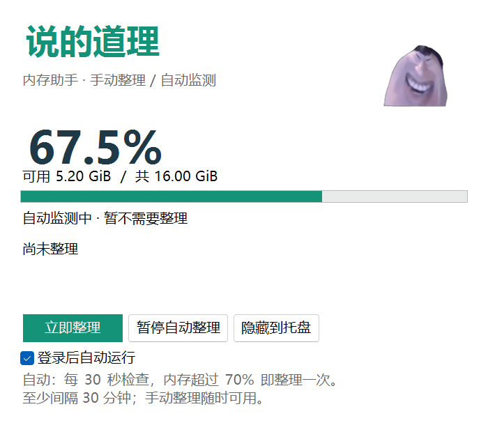

# 说的道理 · 内存助手

一个带“说的道理”原版动画的 Windows 内存整理工具。**内存超过 70% 时自动整理，也能随时手动释放。** 支持托盘常驻、登录自启，下载包自带 .NET 运行库。


**[下载 Windows 完整包](https://github.com/zrx986/memory-guardian/releases/latest)** · [使用说明](docs/USAGE.md) · [开发指南](docs/DEVELOPMENT.md) · [验证记录](docs/VALIDATION.md) · [动画素材说明](docs/ASSETS.md)

## 效果预览




预览由程序的真实 WinForms 控件渲染，内存读数与整理结果使用演示数据。动画播放完整的 13.5 秒动作；隐藏到托盘或最小化后，计时器停止，解码图片释放。

## 能做什么

| 功能 | 行为 |
| --- | --- |
| 自动整理 | 每 30 秒检查，使用率严格大于 70% 时触发 |
| 手动整理 | 点击“立即整理”，或使用托盘菜单、本地命令 |
| 间隔保护 | 自动整理至少相隔 30 分钟，同一轮持续高占用只处理一次 |
| 恢复下一轮 | 使用率低于 65% 并持续 2 分钟后，重新开放自动整理 |
| 全屏避让 | 前台全屏时暂缓自动整理 |
| 暂停与退出 | 可暂停自动模式；关闭窗口收进托盘，托盘“退出”彻底停止 |
| 登录自启 | 当前用户登录后延迟 30 秒运行，可在窗口里取消 |
| 本地控制 | 提供状态查询、整理、暂停、恢复和退出命令 |

工作集整理会把部分暂时不用的页面移出物理内存驻留集。应用再次访问时，页面可能重新载入。它适合临时缓解内存压力；不会消除程序仍持有的内存分配，使用中的应用可能短暂变慢。

## 下载与运行

1. 到 [Releases](https://github.com/zrx986/memory-guardian/releases/latest) 下载 `MemoryGuardian-1.0.1-win-x64.zip`。
2. 解压整个目录，运行其中的 `MemoryGuardian.exe`，按 Windows 提示授权首次部署。
3. 从窗口或任务栏托盘使用工具。首次部署会设置当前用户登录自启。

下载包包含运行库，使用者无需安装 .NET、Python 或开发环境。请保留同目录全部文件。程序为未签名构建，Windows 授权窗口可能显示“未知发布者”；发布页提供 SHA256 校验值。

安装位置为 `%ProgramFiles%\LocalMemoryTools\MemoryGuardian`，配置和本地日志位于 `%ProgramData%\LocalMemoryTools\MemoryGuardian\<用户SID>`。应用不需要联网运行。

## 开发与构建

在 Windows x64 上安装 [.NET 10 SDK](https://dotnet.microsoft.com/download/dotnet/10.0)，然后：

```powershell
git clone https://github.com/zrx986/memory-guardian.git
cd memory-guardian
pwsh ./build/Test.ps1
pwsh ./build/Publish.ps1
```

完整程序、文件清单、ZIP 和校验值会生成到 `output/`。默认构建不会部署程序、修改登录自启或执行真实内存整理。详细架构、调试方法和发布流程见 [开发指南](docs/DEVELOPMENT.md)。

## 项目结构

```text
src/MemoryGuardian.Core/       自动整理策略与时间状态
src/MemoryGuardian.App/        WinForms、原版动画、Windows 内存接口、本地控制
tests/                        策略、权限、控制通道及动画生命周期验证
build/                        测试、发布、素材转换与预览生成
docs/                         使用、开发、测试和素材说明
```

原创代码采用 [MIT](LICENSE) 许可证。第三方动画单独标注来源和授权范围，见 [素材说明](docs/ASSETS.md)。欢迎通过 Issue 反馈问题，或按 [贡献指南](CONTRIBUTING.md) 提交改进。
