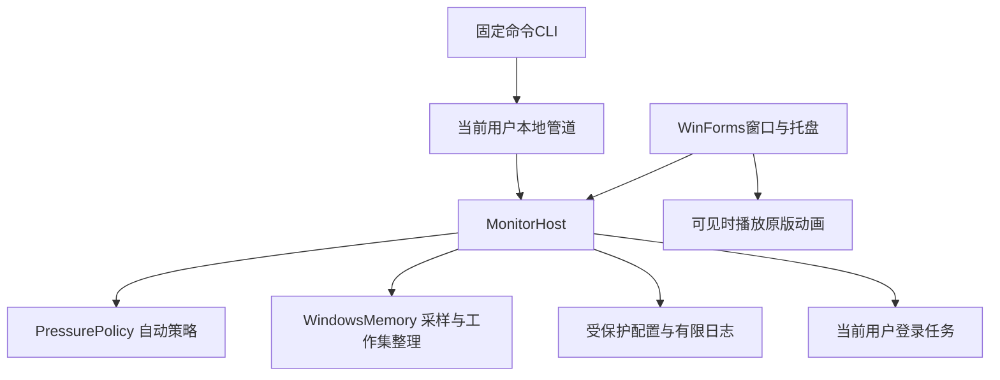

# 开发指南

## 环境

- Windows x64；桌面应用使用 WinForms。
- .NET 10 SDK。`global.json` 固定起始SDK为10.0.403并允许同一主版本的较新功能带。
- PowerShell 7用于测试与发布脚本。

项目没有额外NuGet业务依赖。发布为Windows x64自包含目录，运行时随包交付。

## 常用命令

```powershell
# 全部普通检查：不进行真实整理，不修改自启
pwsh ./build/Test.ps1

# 自包含发布、文件清单、ZIP和SHA256
pwsh ./build/Publish.ps1

# 只读诊断
./output/MemoryGuardian/MemoryGuardian.exe --probe

# 重新生成README预览，读数均为模拟数据
pwsh ./build/Preview.ps1
```

如果SDK不在PATH，给脚本传入 `-Dotnet 'C:\path\to\dotnet.exe'`。真正使用程序才需要管理员授权；普通编译与隔离测试不需要。

## 架构



### Core

`PressurePolicy`是独立于Windows界面的状态机。默认阈值严格>70%，没有额外可用量门槛或高占用持续门槛。自动冷却30分钟，一轮高压只尝试一次；<65%持续2分钟恢复资格。启动时用UTC恢复剩余冷却，运行期间用单调计时，避免系统时间改变影响间隔。

### WindowsMemory

通过 `GlobalMemoryStatusEx` 和 `GetPerformanceInfo` 获取物理内存与提交量。整理使用固定的 `NtSetSystemInformation` 工作集操作，临时启用所需特权，并在finally中恢复。失败时保留NTSTATUS和Win32错误。该Windows接口需随目标系统版本验证，不能仅凭编译成功判断清理效果。

### MonitorHost

统一处理采样、自动策略、手动操作和持久化。使用单一信号量阻止并发整理。清理前后采样结果共同保存，界面显示变化值。普通单元测试不会触发此处的真实管理员清理。

### 本地控制

固定四个命名管道实例，避免一次耗时整理阻断状态查询。请求带确认流程，退出等待正在处理的操作及已发送回复被接收。没有任意执行命令或外网控制接口。

### 文件与启动

程序安装到Program Files，设置与有限轮转日志保存在ProgramData的当前用户SID目录。安装检查相对路径、文件哈希与重解析点。登录任务使用受保护的程序路径、最高权限、30秒延迟、无限执行时长，不设置失败后反复重启。

### 动画

原版13.5秒素材按12fps缩为162帧128×128图集并嵌入程序集。窗口隐藏或最小化时停止计时器，并释放约10.5MiB解码像素。再次显示时懒加载；只复制当前帧进行绘制。`RenderPreview`可以离屏渲染指定时刻，便于测试和生成文档。

## 测试分层

| 项目 | 内容 |
| --- | --- |
| `MemoryGuardian.Core.Tests` | 阈值、冷却、恢复、暂停、全屏、时间跳变、24小时模拟 |
| `MemoryGuardian.Native.Tests` | 只读内存接口、未提权拒绝、自启任务查询 |
| `MemoryGuardian.App.Tests` | 管道权限、并发、回复确认、退出等待、结果显示 |
| `MemoryGuardian.Animation.Tests` | 帧变化、完整循环、显隐生命周期、释放图片、布局 |

`tests/Control.Smoke.ps1`用于独立的只读发布实例。它会停止被测试的实例，不应对真实工作中的实例运行。执行前必须确认 `--status` 返回 `ReadOnly=true`。

## 发布流程

1. 更新版本和变更记录。
2. 执行普通测试，生成并查看预览。
3. 运行发布脚本，校验ZIP及逐文件清单。
4. 对发布目录进行防病毒扫描，记录引擎时间、范围和结果；不要用旧扫描结果代替新构建。
5. 创建Git标签和Release，上传完整ZIP、SHA256和发布说明。

`package-manifest.json`是相对路径到SHA256的映射，不包含它自身。原版素材单独注明授权，代码许可证不扩大第三方素材的授权范围。
